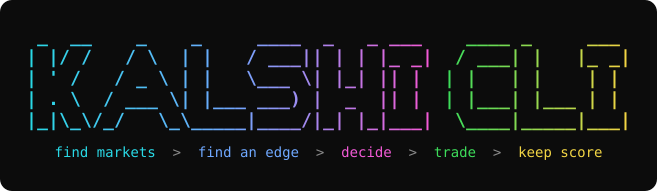
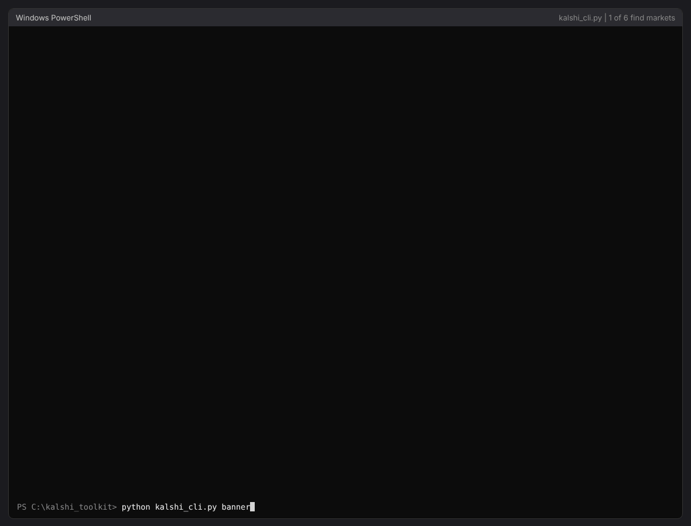
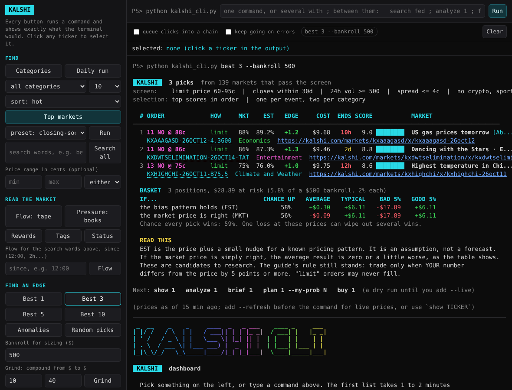

# Kalshi CLI



Kalshi CLI is one command-line tool for Kalshi prediction markets, plus the strategy guide it is built around. `kalshi_cli.py` finds markets, looks for an edge, helps you decide, optionally places orders, and keeps score. Run it in a terminal, or run `serve` to get the same thing as a dashboard in your browser.

Kalshi is a regulated exchange where you trade yes-or-no contracts on real events: Fed decisions, inflation, weather, elections, sports. Each contract costs 1 to 99 cents and pays $1 if you are right. This project started as a question, "what does it actually take to make money there?", and turned into a guide that answers it and a tool that does the math.

It does not predict outcomes and it is not financial advice. Research on Kalshi found the average trader loses money. The tool shows you the numbers, including the unflattering ones, so you can see what you are getting into.

## New here? Start with these

No coding needed. Two PDFs you can open right now:

- **[The strategy guide](guide/Kalshi_Strategy_Roadmap.pdf)** (8 pages). How Kalshi works, what it realistically takes to reach $1,000 to $25,000 in profit, what to trade, what to avoid, and how to size your bets. There is also a [10-minute audio version](guide/Kalshi_Strategy_Roadmap_Audio.mp3).
- **[A sample "firehose" report](docs/firehose_sample.pdf)** (74 pages). This is what the tool produces when one command runs everything it can do: the busiest markets, the biggest movers, prices that don't add up, top picks, and one market taken all the way down to its order book. It is a snapshot of live data from October 11, 2026.

GitHub previews both in the browser. Click the download button on the PDF's page to get the clickable table of contents and full-quality color.

The `templates/` folder has plain checklists to go with the guide: a pre-trade checklist, a risk rules card, a phased roadmap, and review sheets.

## For the technical crowd

One Python file, standard library only. Trading is the one part that needs an extra package.

```powershell
git clone https://github.com/pjcampbe11/kalshi-toolkit.git
cd kalshi-toolkit
python -m pip install -r requirements.txt      # only needed for trading
python kalshi_cli.py examples                  # about 120 example commands, explained
python kalshi_cli.py search bears packers      # every open market matching those words
python kalshi_cli.py flow                      # what is trading now, and which way the money leans
python kalshi_cli.py best 3                    # the three top-scoring markets
python kalshi_cli.py multiply 5x --stake 20    # ways to turn $20 into $100 within 3 days
python kalshi_cli.py multiply --sweep          # 16 multiply variations into one text file
python kalshi_cli.py firehose --open           # everything, as one color PDF
python kalshi_cli.py serve                     # dashboard at http://127.0.0.1:8765, opens in Chrome
python kalshi_cli.py selftest                  # check that everything works here
```

- **Needs:** Python 3.9 or newer. Works on Windows, macOS and Linux.
- **No API key** for finding, analyzing, planning or logging. A key is only for placing orders and reading your account.
- **First run** downloads about 140,000 open markets and takes 1 to 2 minutes. After that the list is cached for 30 minutes.
- **Orders are dry runs** until you add `--live` and type a confirmation word. The trading commands were tested against a stand-in server, not a funded account, so start with `--demo` or one small order.
- **Prefer a virtual environment?** The steps are in [Install](#install).

What is under the hood: a screener over every open market, anomaly checks (outcome sets whose bids add past $1, threshold ladders priced out of order, z-score moves, volume surges), implied probability distributions, a Kelly-based trade planner, basket and compounding simulations, a stake multiplier that compares single-bet and multi-bet routes to 2x / 3x / 5x / 10x, a trade log scored for calibration, a localhost dashboard, and a dependency-free PDF writer. Every command, option and formula is documented below.

## See it run



The demo runs every command in the terminal and then the dashboard. The trading frames use sample data from a local test server, as their title bar says.

## Contents

- [New here? Start with these](#new-here-start-with-these)
- [For the technical crowd](#for-the-technical-crowd)
- [See it run](#see-it-run)
- [What it does and what it cannot do](#what-it-does-and-what-it-cannot-do)
- [Install](#install)
- [Quick start](#quick-start)
- [The workflow](#the-workflow)
- [Files in this repo](#files-in-this-repo)
- [Command reference](#command-reference)
  - [Global options](#global-options)
  - [Find markets](#find-markets)
  - [Find an edge](#find-an-edge)
  - [Decide](#decide)
  - [Trade](#trade)
  - [Keep score](#keep-score)
  - [Help and dashboard](#help-and-dashboard)
- [Firehose: everything in one PDF](#firehose-everything-in-one-pdf)
- [The dashboard](#the-dashboard)
- [Output formats and color](#output-formats-and-color)
- [API key and settings](#api-key-and-settings)
- [How the math works](#how-the-math-works)
- [Example commands](#example-commands)
- [The guide, templates and prompts](#the-guide-templates-and-prompts)
- [What was tested](#what-was-tested)
- [Disclaimer](#disclaimer)

## What it does and what it cannot do

**It does:**

- Download every open Kalshi market (about 140,000) and screen them any way you like.
- Show one market in depth: prices, fees, break-even, rules, order book, price history, statistics.
- Search every open market by keyword, phrase, pattern or Kalshi's own tags, and return all of it.
- Find prices that break arithmetic, and prices that break their own pattern.
- Read the trade tape and the order books: which side takers are buying, where resting money leans, the largest trades.
- List the markets where Kalshi pays traders for resting orders, and show where each market's answer officially comes from.
- Rank markets, build diversified baskets, and simulate what a basket or a compounding chain could do.
- Take a stake and a target multiple (2x, 3x, 5x, 10x) and lay out a single bet, a chain of bets and a spread of bets that could reach it within a week, with the odds of each.
- Turn your own probability into an edge, a Kelly-based size, a checklist verdict and a ready order.
- Place limit orders, behind several safeguards, if you give it an API key.
- Keep a trade log and score you against the guide's rules.

**It cannot predict outcomes.** Every score and estimate here is arithmetic on market prices, plus one stated assumption about a known pricing pattern. Research on Kalshi found the average trader loses money. An edge exists only when your own probability is better than the market's, and the trade log is how you find out whether yours is.

## Install

Assuming nothing is installed yet.

**1. Python 3.9 or newer.** Check with `python --version`. If it is missing:

```powershell
winget install Python.Python.3.12
```

Close and reopen PowerShell afterwards. Git and the GitHub CLI are only needed to clone or publish the repo: `winget install Git.Git` and `winget install GitHub.cli`.

**2. Get the code.**

```powershell
git clone https://github.com/pjcampbe11/kalshi-toolkit.git
cd kalshi-toolkit
```

**3. Install the dependencies.** One line, from the repo folder:

```powershell
python -m pip install -r requirements.txt
```

`requirements.txt` holds one package, `cryptography`, which signs requests to your Kalshi account. Everything except trading runs without it. If you already have a package, pip skips it; to stop pip touching one at all, put a `#` in front of its line in the file.

### Option: use a virtual environment

A virtual environment keeps this tool's packages separate from the rest of your Python. From the repo folder:

```powershell
python -m venv .venv                         # 1. create it (once)
.\.venv\Scripts\Activate.ps1                 # 2. turn it on (every new PowerShell window)
python -m pip install --upgrade pip          # 3. update pip inside it
python -m pip install -r requirements.txt    # 4. install the dependencies
python kalshi_cli.py examples                # 5. run the tool
deactivate                                   # when you are done
```

Your prompt shows `(.venv)` while it is on.

- If step 2 says scripts are disabled, run this once and try again: `Set-ExecutionPolicy -Scope CurrentUser RemoteSigned`
- On macOS or Linux, step 1 is `python3 -m venv .venv` and step 2 is `source .venv/bin/activate`.
- To start over, delete the `.venv` folder and repeat the steps. It is already in `.gitignore`.

The whole thing as one line:

```powershell
python -m venv .venv; .\.venv\Scripts\Activate.ps1; python -m pip install --upgrade pip; python -m pip install -r requirements.txt
```

## Quick start

Finding, analyzing, planning and logging need only Python.

```powershell
python kalshi_cli.py examples          # about 120 example commands with explanations
python kalshi_cli.py categories        # what is open
python kalshi_cli.py best 3            # the three top-scoring markets
python kalshi_cli.py multiply 5x --stake 20   # ways to turn $20 into $100 within 3 days
python kalshi_cli.py serve             # the dashboard at http://127.0.0.1:8765
```

The first list command downloads every open market and takes 1 to 2 minutes. The list is then saved for 30 minutes, so later commands are instant. Put `--refresh` before a command to download again. Single-market commands (`show`, `analyze`, `plan`, `buy`) are always live.

Trading needs an API key and one package. See [API key and settings](#api-key-and-settings).

## The workflow

Every market has a unique **ticker**, printed under each row with its kalshi.com link. After any list, the **row number** works anywhere a ticker does, so you can move from a list to a decision to an order without retyping anything.

```powershell
python kalshi_cli.py best 3                              # 1. find candidates
python kalshi_cli.py analyze 1 --deep                    # 2. look closely at row 1
python kalshi_cli.py brief 1 --copy                      # 3. get a research prompt, ask an AI, get a probability
python kalshi_cli.py plan 1 --my-prob 78 --bankroll 500  # 4. your number in, sized order out
python kalshi_cli.py buy 1                               # 5. preview the order (dry run)
python kalshi_cli.py buy 1 --live                        # 6. send it, after typing BUY
python kalshi_cli.py log add ...                         # 7. record it (the line is printed for you)
python kalshi_cli.py log stats --deposits 500            # 8. see whether you actually have an edge
```

Most commands end with an **In plain words** block that says what the numbers mean, and a **Next** line with the command to run from there.

## Files in this repo

| File | What it is |
|---|---|
| `kalshi_cli.py` | The tool. One file, standard library only (trading also needs `cryptography`) |
| `requirements.txt` | The one package to install, with notes on what needs it |
| `docs/EXAMPLES.md` | Every example command with what it does |
| `docs/demo.gif`, `docs/dashboard.png` | The demo above and a dashboard screenshot |
| `docs/firehose_sample.pdf` | A sample of the PDF that `firehose` produces |
| `guide/Kalshi_Strategy_Roadmap.pdf` | The strategy guide (8 pages, clickable contents) |
| `guide/Kalshi_Strategy_Roadmap_Audio.mp3` | Audio version, 10.6 minutes |
| `guide/audio_narration_script.txt` | The text the audio was read from |
| `trade_log_template.csv` | Empty trade log with the right columns |
| `sample_trade_log.csv` | 40 made-up trades for trying the scorecard |
| `templates/` | Pre-trade checklist, risk rules card, roadmap phase gates, review templates, niche worksheet, tax records checklist |
| `prompts/` | The master prompt that rebuilds this package, and seven module prompts |
| `prompts_used.txt` | The original prompts, verbatim |
| `CHANGES.md` | What changed since the last handoff |

## Command reference

Run any command as `python kalshi_cli.py <command>`. Add `-h` to a command for its full option list.

### Global options

These go **before** the command: `python kalshi_cli.py --refresh top ...`

| Option | What it does |
|---|---|
| `--refresh` | Download the market list again instead of using the saved copy |
| `--cache-minutes N` | How long a saved market list stays good (default 30) |
| `--color auto/always/never` | Colored output. `auto` is on in a terminal and off when piped |
| `--links auto/always/never` | Clickable links in the terminal. `auto` is on in a terminal and off when piped. Use `never` if your terminal shows stray characters |
| `--no-banner` | Skip the banner that shows the first time the tool runs on a computer |
| `--demo` | Use Kalshi's practice exchange with practice money. Needs a demo API key |

### Find markets

#### `categories`

Every category with open markets: event and market counts, 24-hour volume, and share of all trading. The first column is the short name to type.

#### `top`

The screener. Filters, ranks and cuts to the top N.

| Group | Options |
|---|---|
| What to look at | `--category NAME...`, `--skip-category NAME...`, `--category-name "Exact Name"`, `--search WORD...`, `--any-word`, `--exclude WORD...`, `--series TICKER...` |
| Price in cents | `--under N`, `--over N`, `--min-price N`, `--max-price N`, `--side yes/no/either` |
| Activity | `--min-volume-24h N`, `--min-volume N`, `--min-interest N`, `--min-move CENTS`, `--max-spread CENTS`, `--min-spread CENTS` |
| Timing | `--closes-within DAYS`, `--closes-after DAYS`, `--opened-within DAYS` |
| Ranking | `--sort NAME`, `--top N` (default 10), `--one-per-event`, `--preset NAME` |
| Output | `--format table/json/csv/markdown`, `--out FILE`, `--open N`, `--no-links` |

**Categories:** ai, business, commodities, companies, crypto, economics, elections, entertainment, financials, health, mentions, politics, social, sports, tech, transportation, weather, world.

**Sorts:**

| Sort | Ranks by |
|---|---|
| `hot` (default) | Contracts traded in the last 24 hours |
| `volume` | Contracts traded all time |
| `interest` | Contracts currently held |
| `movers`, `gainers`, `losers` | Price change since yesterday |
| `closing` | Closing soonest |
| `newest` | Opened most recently |
| `cheapest`, `priciest` | Price to buy |
| `wide-spread`, `tight-spread` | Gap between bid and ask |

**Presets** (any option you add overrides the preset):

| Preset | What it finds |
|---|---|
| `hot` | Most traded in the last 24 hours |
| `longshots` | Contracts under 10 cents |
| `favorites` | Contracts at 85 cents and up |
| `coinflips` | Contracts between 40 and 60 cents |
| `movers` | Biggest price change since yesterday |
| `closing-soon` | Closing in the next 2 days |
| `new` | Opened in the last 2 days |
| `wide` | Bid-ask gap of 5 to 20 cents with real volume |
| `tight` | Bid-ask gap of 2 cents or less |
| `guide` | Fits the guide: 60 to 95 cents, closes within 30 days, active, no sports or crypto |

**Reading the table:** BUY is the side and price you would pay now. YES b/a is the best bid and ask. CHG is the change since yesterday. SPRD is the bid-ask gap. PAYS is what $1 becomes if that side wins. ENDS is the time to close. YES is green and NO is magenta throughout.

#### `show TICKER`

One market, live: both sides' bid and ask, what $1 pays, the market-order fee, the break-even probability, the rules, and the order book as depth bars. `--full-rules` adds the secondary rules. `--depth N` sets the book levels. `--open` opens the page.

#### `event EVENT_TICKER`

Every market inside one event, sorted by price, with the YES prices added up.

#### `analyze TICKER`

Price history as a text chart with a volume strip, then statistics: start to now, range, average, typical move, biggest move, trend, volume, open interest, and how far the price could wander before close.

| Option | What it does |
|---|---|
| `--days N` | How far back (default 14; at most 7 with hourly points) |
| `--interval day/hour` | One point per day (default) or per hour |
| `--book` | Drill down: the order book with depth on each side |
| `--trades N` | Drill down: the last N trades and who was buying |
| `--deep` | Drill down into everything |
| `--height ROWS` | Chart height (default 8) |
| `--format json`, `--out FILE` | Statistics and history as data |

#### `ladder EVENT` (also `dist`)

An event's prices as a probability distribution. For a threshold ladder ("above 3.4%", "above 3.6%"...) it shows the chance of landing in each range and the implied median. For named outcomes it shows fair odds with the built-in margin removed. Accepts an event ticker, a market ticker or a row number.

#### `watch TICKER...` and `open TICKER`

`watch` re-checks markets every `--every SECONDS` (default 60) and prints a line when a price moves; `--count N` stops after N checks. `open` opens the kalshi.com page in your browser.

#### `search WORD...` (also `find`)

Every open market matching your keywords, in every category including sports and crypto, with **no top-N cut**. It first shows how the matches group into events, then lists every market.

```powershell
python kalshi_cli.py search bears packers                  # every market matching both words
python kalshi_cli.py search bears packers --group          # the matching events, with a market count each
python kalshi_cli.py search fed rate --any --limit 20      # either word, first 20
python kalshi_cli.py search rate cut --phrase --not september
python kalshi_cli.py search --tag Fed --closes-within 30   # Kalshi's own tag
python kalshi_cli.py search weather --format csv --out weather_all.csv
```

| Option | What it does |
|---|---|
| `WORD...` | Keywords. All must match unless `--any` is given |
| `--any` | Match any of the words |
| `--phrase` | The words must appear together, in that order |
| `--not WORD...` | Leave out markets containing any of these |
| `--regex PATTERN` | A regular expression, instead of or as well as words |
| `--in FIELD...` | Look only in `title`, `event`, `ticker`, `series` or `category` (default: all) |
| `--tag TAG...` | Only series carrying this Kalshi tag (see `tags`) |
| `--series TICKER...` | Only these series |
| `--category`, `--skip-category` | Keep or drop categories |
| `--under CENTS`, `--over CENTS` | Only markets with a side you can buy inside that price |
| `--closes-within DAYS`, `--min-volume-24h N` | Time and activity filters |
| `--sort HOW` | Same orders as `top` (default `volume`) |
| `--limit N` | Stop after N (default 0 = show all) |
| `--group` | List matching events instead of every market |
| `--count` | Print only how many markets and events match |
| `--tickers` | Print only tickers, one per line |
| `--format`, `--out`, `--no-links` | As on `top` |

`top --search WORD --top 0` also lists everything; `--top 0` means no cut.

#### `tags`, `sources TICKER`, `status`

- `tags [CATEGORY]`: the tags Kalshi files its markets under ("Fed", "Daily temperature", "BTC"), for use with `search --tag`.
- `sources TICKER_OR_SERIES`: where the answer comes from. Prints the official settlement source with its link, the contract terms, the fee type and multiplier, scheduled fee changes, and who is not allowed to trade it. `--json` gives the raw record.
- `status`: whether the exchange is open and whether maintenance is scheduled.

### Find an edge

#### `flow [TICKER]` (also `tape`)

Reads the public trade tape. Every trade records which side was the taker, the trader who crossed the spread to get filled at once. A tape where takers keep buying one side is a clue the resting quotes do not show.

```powershell
python kalshi_cli.py flow                                          # the whole exchange, last 2,000 trades
python kalshi_cli.py flow KXFEDDECISION-26OCT-H0 --hours 24        # one market in detail
python kalshi_cli.py flow --search bears packers --since 12:00     # every matching market since noon, local time
python kalshi_cli.py flow --search CHIGB --since noon --markets 60 --by lean
```

- **One market:** trades, contracts, dollars, taker YES against taker NO, the average price paid, the window cut into time slices, and the largest single trades.
- **`--search WORD...`:** the same totals for every matching market, side by side, busiest first (`--markets N`, default 25).
- **No ticker, no search:** the busiest markets on the exchange right now.

Options: `--since WHEN` (`12:00`, `12pm`, `noon`, `2h`, `90m`, or `2026-10-11 12:00`, all in your local time) or `--hours N`; `--trades N` per market (2000); `--by volume|lean|dollars|big`; `--min-contracts N`; `--category`; `--buckets N` (8); `--top N`; `--format`; `--out`; `--no-links`.

A lean shows who was impatient, not who was right. One large account can be most of it, and the output says so when it is.

#### `pressure`

Reads resting orders instead of trades: among the busiest markets, which order books have far more dollars bidding for one side near the top of the book. The `1 ORDER` column turns yellow when a single order is half or more of that money, because one order can be pulled in a second.

Options: `--search`, `--category`, `--skip-category`, `--scan N` markets to check (200), `--within CENTS` of the best bid (3), `--min-lean` (0.5), `--min-depth USD` (500), `--min-volume-24h` (1000), `--min-price` / `--max-price` (8 to 92), `--top` (15), `--format`, `--out`.

#### `rewards` (also `incentives`)

Lists markets where Kalshi currently runs an incentive program, with the size of the pool, its period, the target size, and how the market looks now. A liquidity program shares its pool among traders whose limit orders rest near the best price. This is one of the few edges that does not depend on predicting anything. The pool is shared, the rules are Kalshi's, and a resting order can still be filled at a bad moment.

Options: `--status active|upcoming|closed|all`, `--type all|liquidity|volume`, `--by reward|quiet|spread`, `--min-reward USD`, `--search`, `--category`, `--top` (20), `--format`, `--out`.

#### `anomalies`

Scans for things that are wrong by arithmetic, or unusual against a market's own history.

| Kind | What it means |
|---|---|
| `overround` | Only one outcome can win, yet the YES bids add past $1. Buying NO on every outcome locks in the difference |
| `ladder` | A harder threshold is priced above an easier one. Buying YES on the easy one and NO on the hard one costs less than the $1 the pair must pay |
| `underround` | The YES asks add to under $1. Only wins if one listed outcome must happen, so read the rules |
| `move` | Today's move divided by that market's own typical daily move (a z-score). Flags 2.5 and above |
| `surge` | Today's volume at 4 times or more the market's average day |
| `dislocation` | The bid and ask have moved well away from the last traded price |

Options: `--type KIND...`, `--category NAME...`, `--skip-category [NAME...]` (default leaves out sports and crypto, because finishing games look like anomalies), `--min-edge CENTS` (default 0.5 after fees), `--min-volume-24h N`, `--checks N` (movers tested against their own history, default 20), `--top N` per section, `--format`, `--out`.

Findings use the saved market list and quoted sizes can be tiny. Confirm with `show` before acting.

#### `best [N]`

The top-scoring market after the guide's screen, or the top N: `best`, `best 3`, `best 5`, `best 10`. `--by odds` ranks by the best chance of winning instead of the best score; `--by soonest` ranks by what resolves first. Takes the same screening options as `picks`.

#### `picks`

Screens by the guide's rules, scores what is left, draws a diversified set (one per event, two per category), sizes each position, and simulates the basket 20,000 times.

| Option | Default | What it does |
|---|---|---|
| `--top N` | 5 | How many picks |
| `--category`, `--skip-category`, `--search` | no sports or crypto | What to consider |
| `--min-price`, `--max-price` | 60, 95 | Limit price band in cents |
| `--closes-within DAYS` | 30 | Only markets resolving this soon |
| `--min-volume-24h N` | 500 | Minimum trading activity |
| `--max-spread CENTS` | 4 | Widest bid-ask gap to trust |
| `--bankroll USD`, `--risk PCT` | 500, 2 | Sizing |
| `--by score/odds/soonest` | score | How to rank |
| `--bias X` | 1.0 | Strength of the pricing-pattern adjustment; 0 trusts the price exactly |
| `--seed N`, `--no-random` | random draw | Fix the draw, or take the top in order |
| `--format`, `--out` | table | Output |

The EST column is the market price plus about one point for the favorite-longshot pattern. It is an assumption, not a forecast. The basket table also shows the result if the market price is simply right, which averages zero or slightly worse.

#### `grind`

Compounds a small stake through a chain of likely winners that resolve one after another: $10, $10.56, $11.18 and so on. It builds the chain, shows the bankroll after each win, and gives the odds of the whole chain under several staking plans.

Options: `--start USD` (10), `--target USD` (40), `--stake PCT` of bankroll per step (100), `--min-price` (85), `--max-price` (97), `--closes-within DAYS` (3), `--min-volume-24h` (1000), `--max-spread` (3), `--steps N` (15), `--category`, `--skip-category`, `--bias`.

The arithmetic to know before using it: each step is likely, but the chain is only as likely as all its steps multiplied together. At fair prices, turning $10 into $40 succeeds about 25% of the time however it is sliced, and every step pays a fee. `grind` shows that plainly instead of hiding it.

#### `multiply [MULTIPLE]` (also `x`)

You name a stake and the return you want. It finds bets that resolve inside a few days and lays out up to three ways to try for it, side by side.

```powershell
python kalshi_cli.py multiply 2x --stake 10              # $10 into $20, default 3-day window
python kalshi_cli.py multiply 5x --stake 20 --days 5     # $20 into $100, up to 5 days out
python kalshi_cli.py multiply 10x --stake 100 --days 7   # $100 into $1,000, the longest window allowed
python kalshi_cli.py multiply 3x --stake 20 --route single   # only the one-bet route
python kalshi_cli.py multiply 3x --stake 20 --route multi    # only the several-bet routes
python kalshi_cli.py multiply --sweep                        # 16 variations, commands + output, into multiply_results.txt
```

| Route | What it is | It works when |
|---|---|---|
| **single** | One contract priced near 100 / multiple cents. A 5x is a contract near 20c | that one bet wins |
| **chain** | Two to four likelier bets in a row. Each win becomes the stake for the next | every bet wins |
| **spread** | Two to four cheaper bets placed together, sized so one winner pays the whole target | any one bet wins |

Under the three sections comes a side-by-side table (what you put in, what you get, the chance under the tool's estimate and under plain market prices, the average result per attempt, how long it takes) and then the exact `buy` lines for each route, as dry runs. Row numbers run across all three sections, so `show 6` or `buy 6 --take` works on any bet listed.

Options: `MULTIPLE` is `2x` (default), `3x`, `5x`, `10x` or any number from 1.1 to 50. `--stake USD` (10). `--days N` (3; anything over 7 is cut back to 7). `--route all|single|multi|chain|spread` (all). `--max-bets 2|3|4` for the chain and spread (3). `--top N` single bets to list (5). `--min-volume-24h` (300), `--max-spread` (4), `--category`, `--skip-category`, `--bias`, `--no-links`, `--format table|json|csv|markdown`, `--out FILE`. `--sweep [FILE]` runs 16 preset variations (every route, several stakes, multiples, windows and categories) and writes each command followed by its output to one plain-text file, `multiply_results.txt` unless you name another.

What to know before using it: the routes change the shape of the risk, not the odds. At fair prices a 5x comes in about one time in five whether it is one bet, a chain or a spread, and each route pays the taker fee, so the average result at market prices is a small loss. The chain's later bets are sized from today's prices; re-run the command before placing each one. The spread assumes its markets are unrelated.

### Decide

#### `brief TICKER`

Writes a research prompt for an AI assistant: the question, the exact resolution rules and sources, and a request for a base rate, dated evidence, a probability with a range, and what would change it. The market price is given last, for comparison only, so the estimate is not anchored on it. `--copy` puts it on the clipboard; `--out FILE` saves it. The tool does not call any AI service itself.

#### `plan TICKER --my-prob PCT`

Your probability in; a decision out. For each way into the market it shows the edge, expected return, the edge if you are 5 points too confident, the Kelly share, and a sized order. Then it runs the guide's checklist and gives a verdict: WORTH PLACING, MARGINAL or SKIP.

Options: `--bankroll USD` (500), `--side yes/no`, `--kelly X` share of full Kelly (0.25), `--max-risk PCT` cap (3).

#### `fee`, `watchlist`, `daily`

- `fee --price CENTS --contracts N`: the market-order fee and the break-even it implies.
- `watchlist`, `watchlist add TICKER --note "..."`, `watchlist remove TICKER`, `watchlist clear`: markets you are following, with the move since you added each.
- `daily`: watchlist, anomalies, top picks and your scorecard in one run. `--picks N`, `--bankroll USD`.

### Trade

Optional. Needs an API key.

| Command | What it does |
|---|---|
| `buy TICKER --side yes/no --price CENTS --count N` | Preview or place a limit buy. `--spend USD` sizes by dollars. `--take` allows an immediate fill at the ask. `--my-prob` and `--bankroll` add the edge and sizing checks |
| `sell TICKER --side yes/no --count N --price CENTS` | Preview or place a limit sell of contracts you hold |
| `orders` | Your resting orders. `--status executed/canceled` for others |
| `cancel ORDER_ID` | Cancel one resting order. `--all` cancels every one |
| `positions` | Cash balance and holdings, with what each would fetch now |

**Safeguards:**

- **Dry run by default.** `buy`, `sell` and `cancel` show exactly what would be sent and stop. Nothing is sent without `--live`, and then you must type `BUY`, `SELL` or `CANCEL`.
- **Limit orders only.** Buys rest on the book (post-only) and pay no fee on most markets, unless you add `--take`.
- **Per-order cap** of $25. Change it with `--max-cost` or `KALSHI_MAX_ORDER_USD`.
- **Sells are checked** against what you hold, so you never open the opposite side by accident.
- **No automatic retry.** If the connection drops mid-send, the tool says so and tells you to check `orders` and `positions`.
- **Practice exchange.** `--demo` before the command uses Kalshi's demo exchange.

**Read before using `--live`.** The trading commands were tested against a stand-in server that checks the request signature and body, and the real Kalshi order endpoint was confirmed to accept the request path and reject a bad key cleanly. They have not been run against a funded account. Start with `--demo`, or one small order you would be fine losing.

### Keep score

The trade log is one CSV file. Its path is `--file PATH` after `log`, or the `KALSHI_LOG` environment variable, or `trade_log.csv` in the current folder.

| Command | What it does |
|---|---|
| `log init` | Create an empty log |
| `log add --ticker T --side yes/no --price C --contracts N --my-prob P` | Record a trade. Also `--bankroll`, `--order-type limit/market`, `--fee`, `--niche`, `--thesis`, `--rules-read`, `--paper`, `--offline` |
| `log settle` | Look up results and close every trade whose market has resolved. `--id N --result win/loss` settles one by hand |
| `log sold --id N --exit-price C` | Record selling before settlement |
| `log stats` | The scorecard. `--deposits USD` enables the stop rules, `--include-paper`, `--json` |
| `log fills --out FILE` | Download your raw fills from Kalshi for tax records. Needs an API key |

`--my-prob` is always your probability that the market resolves YES, even when you buy NO.

**The scorecard shows:** profit after fees, return on stake, win rate against the average price paid, calibration (your probabilities scored against the market's prices), rule slips, the 100-trade test, milestone progress to $1,000 / $5,000 / $10,000 / $25,000, profit by niche, and the monthly 15% and hard 40% stops.

`log add` warns when a trade breaks a rule from the guide (edge under 5 points, price under 15 cents, size over 3%, market order, rules not read). It still records the trade. Every write backs the log up to `trade_log.csv.bak` first.

### Help and dashboard

- `firehose`: run every command into one color PDF. See [Firehose](#firehose-everything-in-one-pdf).
- `examples`: every example command, grouped, with what each does. `--search WORD` filters. `--markdown` prints the list as a document.
- `serve`: the dashboard. `--port N` (default 8765), `--allow-live`, `--no-browser`, `--browser chrome|edge|firefox|brave|default|PATH` (Chrome unless you say otherwise; falls back to your default browser if the one named is not installed).
- `chain "CMD" "CMD" ...`: run several commands in a row. Row numbers carry over, so `chain "search fed rate" "analyze 1" "flow 1"` works. One string with `;` between steps works too. `--keep-going` carries on after a failed step.
- `selftest`: checks the arithmetic, then runs about 30 real commands on live data and prints pass or FAIL for each. `--quick` runs ten; `--offline` runs the arithmetic only. No order is sent.
- `banner`: the name in large colored letters and a short list of where to start. Running the tool with nothing after it shows the same, and it appears once on the first run.

## Firehose: everything in one PDF

```powershell
python kalshi_cli.py firehose --open
```

That one line runs every command the tool has and binds what each printed into a single PDF that looks like the terminal: same layout, same colors, same bars. The first page is a clickable list of contents, and every command is also a bookmark in the PDF sidebar. It takes about 3 minutes, most of it the market download, and needs nothing installed.

See what it produces: [docs/firehose_sample.pdf](docs/firehose_sample.pdf) (53 commands, 74 pages, from live data on October 11, 2026).

What it runs: `categories`, the top of the whole exchange, all ten presets, nine sorts, four categories, `search` twice, `tags`, `status`, `flow`, `pressure`, `rewards`, `anomalies`, `picks`, `best` three ways, `grind` twice, `multiply` three ways, then one market all the way down (`show`, both `analyze` views, `event`, `ladder`, `plan`, a dry-run `buy`, `brief`, `fee`), then your watchlist, your scorecard if a log exists, your positions and orders if a key is set, and the examples. It never sends an order.

| Option | What it does |
|---|---|
| `--out FILE` | Where to write the PDF (default `kalshi_firehose_DATE_TIME.pdf` in the current folder) |
| `--ticker TICKER` | The market to take all the way down (default: the top-scoring pick) |
| `--my-prob PCT` | Your probability of YES for that market, used by the plan. Without it the plan uses the market's own price and shows no edge |
| `--bankroll USD` | Account size for sizing (default 500) |
| `--theme dark/light` | Dark like the terminal, or light for printing |
| `--open` | Open the PDF when it is done |

Put `--refresh` first for fresh prices: `python kalshi_cli.py --refresh firehose --open`

## The dashboard

```powershell
python kalshi_cli.py serve                    # opens in Chrome
python kalshi_cli.py serve --browser edge     # or firefox, brave, default, or a full path
```



The dashboard has no logic of its own. Each button builds a command, the server runs this same script with it, and the page shows the output with the same colors and layout as the terminal. So the two can never disagree.

- **Left side:** buttons and small forms for the common commands: categories, top with filters, presets, search (every match), flow, pressure, rewards, tags, status, best 1 / 3 / 5 / 10, picks, anomalies, grind, multiply (stake, 2x / 3x / 5x / 10x, days, single or multiple bets), and the selected market's show, analyze, ladder, brief, flow, sources, plan and order preview.
- **Top:** a command box that takes anything you could type in the terminal. Up and down arrows recall earlier commands.
- **Chains:** type several commands with `;` between them, for example `search fed rate ; analyze 1 ; flow 1`. They run in order inside one box, and row numbers carry from one step to the next. Tick **queue clicks into a chain** and the buttons add to the command box instead of running, so a chain can be built by clicking. **keep going on errors** runs the rest when a step fails.
- **Recent commands** appear as chips under the box; click one to run it again. **Clear** empties the output.
- **Links:** every address in the output is a link that opens in a new tab.
- **Click any ticker** in the output to select it for the buttons on the left.

Safety: it listens on `127.0.0.1` only, every request must carry a secret token that is baked into the page, and orders are dry runs unless you start it with `serve --allow-live`. Even then, each live order asks you to type the confirmation word.

## Output formats and color

- `top`, `search`, `flow`, `pressure`, `rewards`, `picks`, `best`, `anomalies` and `multiply` take `--format table`, `json`, `csv` or `markdown`, and `--out FILE`.
- `analyze` takes `--format json`. `log stats` takes `--json`.
- `multiply --sweep [FILE]` writes 16 variations, each command followed by its output, to a plain-text file (`multiply_results.txt` by default).
- `firehose` writes everything to one color PDF.
- Output is colored in a terminal and plain when piped to a file. `--color never` or `NO_COLOR=1` turns color off; `--color always` forces it on.
- **Clickable links.** In a terminal, every market address is a real link, and the ticker beside it opens the same page. Ctrl+click in Windows Terminal and VS Code; click or Cmd+click elsewhere. Terminals without link support just show the text. `--links never` or `KALSHI_LINKS=never` turns it off. Links are never written to files or pipes.

```powershell
python kalshi_cli.py top -c weather -n 20 --format markdown --out weather.md
python kalshi_cli.py picks -n 10 --format csv --out picks.csv
python kalshi_cli.py analyze TICKER --format json
python kalshi_cli.py multiply 5x --stake 20 --format csv --out multiply.csv
python kalshi_cli.py multiply --sweep multiply_results.txt
```

## API key and settings

Only trading, `orders`, `cancel`, `positions` and `log fills` need a key.

1. In your Kalshi account settings, create an API key. Kalshi gives you a key ID and a private key file. Save the file somewhere private; Kalshi does not show it again.
2. `python -m pip install -r requirements.txt`
3. In PowerShell:

```powershell
setx KALSHI_API_KEY_ID "your-key-id"
setx KALSHI_PRIVATE_KEY_PATH "C:\path\to\kalshi-key.pem"
```

Open a new PowerShell window afterwards. For the current window only, use `$env:KALSHI_API_KEY_ID = "..."`.

A key can place orders on your account. Treat the `.pem` file like a password and keep it out of the repo. The `.gitignore` already excludes `*.pem`, your real `trade_log.csv`, and raw fills.

| Variable | What it sets |
|---|---|
| `KALSHI_API_KEY_ID`, `KALSHI_PRIVATE_KEY_PATH` | Your API key |
| `KALSHI_LOG` | Path to the trade log |
| `KALSHI_MAX_ORDER_USD` | Per-order dollar cap (default 25) |
| `KALSHI_HOME` | Folder for the watchlist (default `~/.kalshi_cli`) |
| `NO_COLOR` | Set to turn color off |
| `KALSHI_LINKS` | Set to `never` to turn clickable links off |
| `KALSHI_BROWSER` | Browser for `serve`: `chrome` (default), `edge`, `firefox`, `brave`, `default`, or a path |

## How the math works

**Fee.** A market order costs 7% x price x (1 - price) per contract, price in dollars: 1.75 cents at 50 cents, less toward the extremes. Resting limit orders are free on most markets.

**Estimated probability (EST).** The market's midpoint plus a small adjustment for the favorite-longshot pattern: about +1.3 points at 85 cents, 0 at 50 cents, -2 points at 5 cents. `--bias 0` removes it. It is an assumption drawn from published research on Kalshi prices, not a fitted model.

**Score.** Expected return on the money put in (estimated edge divided by price), scaled up for markets that trade a lot and resolve soon, and scaled down when the price moved more than 5 cents today. For a resting limit order the tool assumes that if you get filled, your price was the fair one, so a limit order earns only the adjustment.

**Basket simulation.** `picks` plays the basket 20,000 times with random outcomes, once using EST and once using the market price, and reports the chance it ends up, the average, the typical result, and the bad and good 5% cases.

**Kelly size.** For a contract costing c dollars that pays $1, with your win probability p, the growth-optimal share of bankroll is (p - c) / (1 - c). Full Kelly assumes your probability is exactly right, so `plan` uses a quarter of it and never more than 3% of bankroll.

**Unusual moves.** Today's change divided by the root-mean-square of that market's daily changes over the last 30 days. A 6-cent move is routine in a jumpy market and extraordinary in a calm one.

**Overround.** If only one of n outcomes can win, buying NO on all of them costs the sum of (100 - YES bid) and pays at least 100 x (n - 1). The profit is at least the sum of the YES bids minus 100, less fees.

**Ladder break.** "Above the higher number" cannot be more likely than "above the lower number". If the higher rung's YES bid exceeds the lower rung's YES ask, YES on the lower plus NO on the higher costs under $1 and must pay at least $1.

**Implied distribution.** On a ladder, the chance of landing between two thresholds is the difference between their prices. The implied median is where the chance of being above crosses 50%.

**Grind odds.** The chance of a chain is the product of its steps. At fair prices the chance of multiplying a stake by k is at most 1/k, whatever path is taken.

**Multiply routes.** For a multiple k, a single bet needs a contract costing at most 100 / k cents after the fee. A chain of n bets needs each to return about the n-th root of k, and its chance is the product of the bets' chances. A spread buys the same number of contracts, k x stake, in each market, so the combined price per contract must stay under 100 / k cents; its chance is 1 minus the product of each bet missing, which assumes the markets are independent.

**Taker lean.** In `flow`, lean = (contracts where the taker bought YES - contracts where the taker bought NO) / all contracts. +100% means every taker bought YES. In `pressure` the same formula is applied to dollars resting within a few cents of the best bid on each side.

**Reward pools.** `rewards` shows the pool Kalshi publishes for a market and period. Your share depends on how your resting size compares with everyone else's, which the public data does not show, so the tool does not estimate a payout.

**Calibration.** The Brier score, the average of (forecast - outcome) squared, for your probabilities and for the market's prices on the same trades. If yours is not lower, the profit is probably luck.

## Example commands

All of them, with explanations, are in [docs/EXAMPLES.md](docs/EXAMPLES.md), or run `python kalshi_cli.py examples`. A few to start with:

| Command | What it does |
|---|---|
| `top --category economics --top 10` | The 10 most traded economics markets |
| `top --all --under 10 --top 20` | The 20 busiest contracts at 10 cents or less |
| `top --search fed rate --top 5` | Keyword search |
| `top --preset guide --top 10` | Markets that fit the guide's rules |
| `analyze TICKER --deep` | History, statistics, order book and recent trades |
| `ladder EVENT` | The event as a probability distribution |
| `anomalies` | Prices that break arithmetic or their own pattern |
| `best 5 --by odds` | The five with the best chance of winning |
| `picks --top 10 --bankroll 500` | A diversified basket with simulated odds |
| `grind --start 10 --target 40` | A compounding chain with its real odds |
| `multiply 5x --stake 20` | Single-bet and multi-bet ways to turn $20 into $100 within 3 days |
| `multiply 10x --stake 100 --days 7 --route multi` | Only the several-bet routes, over the full 7-day limit |
| `search bears packers` | Every open market matching both words, no cut |
| `flow --search bears packers --since 12:00` | Trades since noon in every matching market |
| `flow` | What the whole exchange is trading right now, and which way takers lean |
| `pressure` | Order books that lean hard to one side |
| `rewards` | Markets where Kalshi pays for resting orders |
| `sources TICKER` | The settlement source, contract terms and fee type |
| `chain "search fed rate" "analyze 1" "flow 1"` | Several commands in a row |
| `selftest` | Check that everything works on this computer |
| `multiply --sweep` | 16 multiply variations, commands and output, into `multiply_results.txt` |
| `plan TICKER --my-prob 78 --bankroll 500` | Edge, Kelly size, checklist, verdict |
| `buy 1` | Preview the order for row 1 (dry run) |
| `log stats --deposits 500` | The scorecard |
| `daily` | The morning run-through |
| `serve` | The dashboard |

## The guide, templates and prompts

- **`guide/`** holds the 8-page strategy guide as a PDF with a clickable table of contents, an audio version, and the narration text. The guide sets the rules this tool checks: limit orders, a 5-point edge, 1% to 3% per trade, a 100-trade test before adding money, and stop rules.
- **`templates/`** holds the pre-trade checklist, risk rules card, roadmap with phase gates, weekly and 100-trade review templates, niche research worksheet and tax records checklist.
- **`prompts/`** holds `00_MASTER_PROMPT.txt`, one prompt that rebuilds this whole package, and seven module prompts that each rebuild one part. `prompts_used.txt` is the original set, verbatim.

## What was tested

- **Finding and analysis** (`categories`, `top` with every preset, filter group and format, `show`, `event`, `analyze` with each drill-down, `ladder`, `watch`): run against the live Kalshi API on October 10, 2026.
- **Edge finders** (`anomalies`, `best`, `picks`, `grind`, `multiply`): run against live data. The anomaly checks were tightened after early runs flagged false positives, such as events where markets share a threshold type but are separate questions.
- **Multiply:** every route, stake, multiple and window option run against live data, including the 7-day cap, the JSON and CSV output, `buy` from a row number as a dry run, and `--sweep` writing all 16 runs to a text file. Run on Linux and on the Windows machine's Linux shell; the orders it prints were only ever dry runs.
- **Search and market reading** (`search` with every option, `tags`, `sources`, `status`, `flow` in all three modes, `pressure`, `rewards`, `chain`): run against live data on October 11, 2026, including a search and a noon-onward tape for a live NFL game. The built-in `selftest` runs 13 arithmetic checks and 30 commands; all 43 pass here.
- **Clickable links and banner:** checked in a real pseudo-terminal (links are written) and through a pipe (they are not). Not checked by eye in Windows Terminal or the classic PowerShell window.
- **Browser choice** (`serve --browser`): the code path that falls back to the default browser was run; opening Chrome, Edge, Firefox or Brave by name on Windows was not, since the build machine is Linux.
- **Deciding** (`plan`, `brief`, `fee`, `watchlist`, `daily`): run against live data.
- **Trade log** (`log init`, `add`, `settle`, `sold`, `stats`): run against live data, including settling a real resolved market. Fee math was checked against Kalshi's published example.
- **Trading** (`buy`, `sell`, `orders`, `cancel`, `positions`): run against a stand-in server that verifies the request signature and body. The real order endpoint was confirmed to answer a bad key with a clean refusal, and dry runs were checked against live markets.
- **Firehose:** run end to end; the PDF was checked for valid structure, working contents links and bookmarks, and its pages were inspected.
- **Dashboard:** driven in a browser, including the token check, the address check and the refusal of live orders.
- **Not tested:** any trading command against a funded account or the demo exchange, and `log fills`, since those need your key. `--open`, `open` and `brief --copy` were not run because the build machine has no browser or clipboard.

## Disclaimer

This is general information and software, not financial, legal or tax advice. Fees, rules and the legal status of event contracts change; check them in the Kalshi app before funding an account. Only risk money you can afford to lose.
